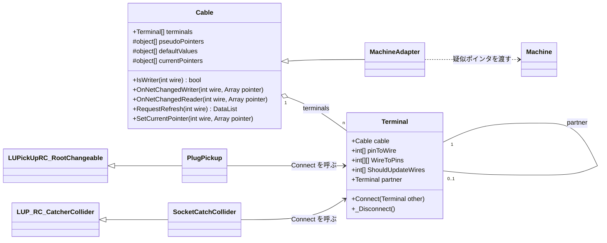
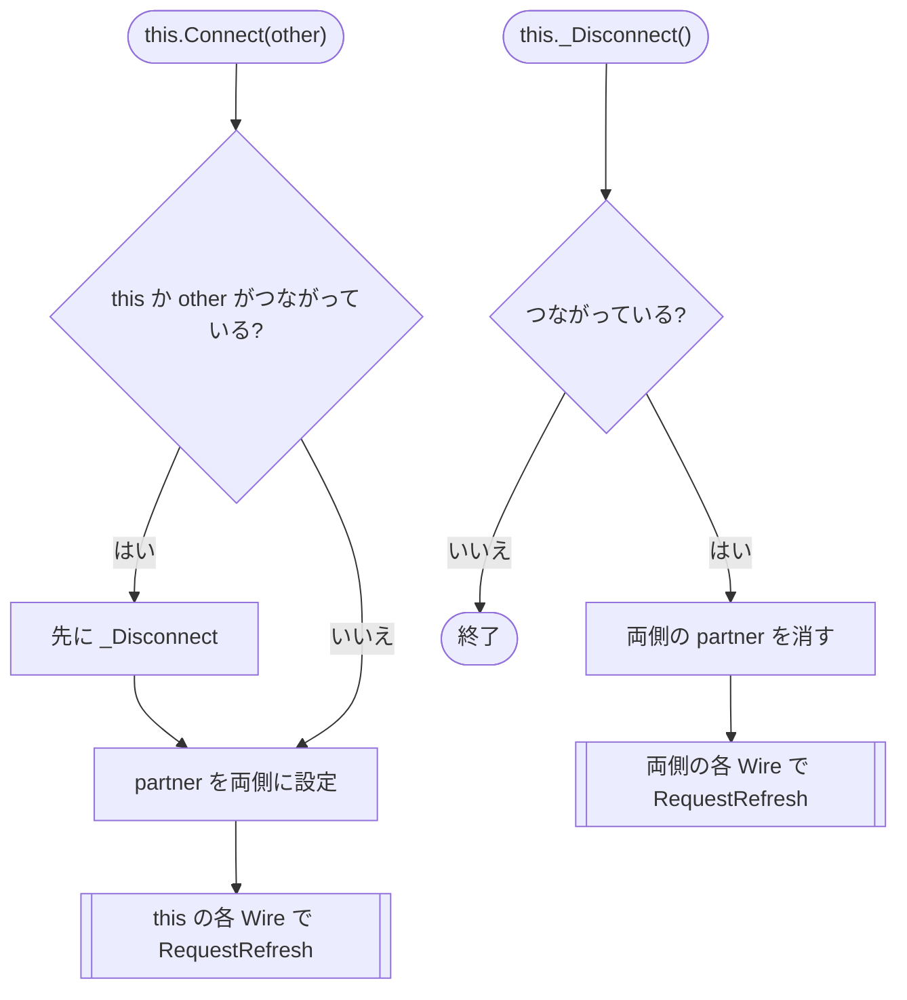
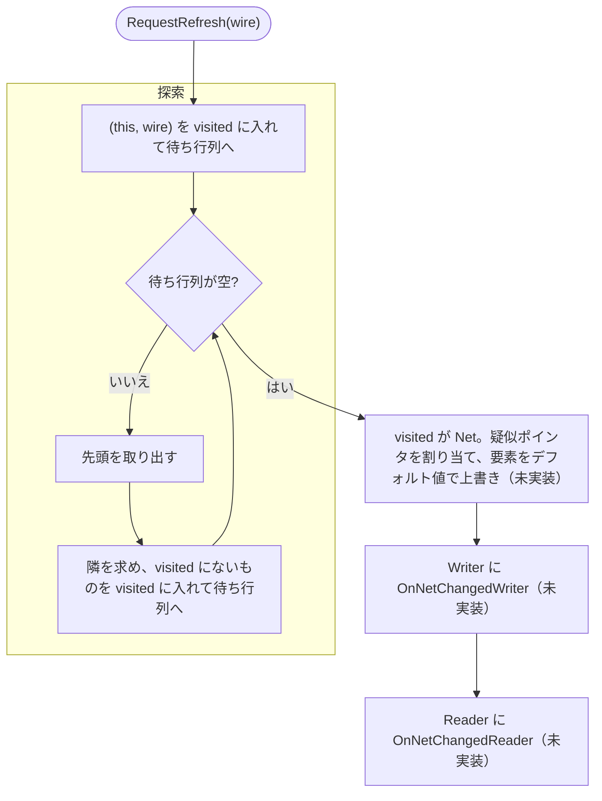

# UdonSharpPickupCable 設計メモ

2026-11-07 時点。Terminal の接続・切断と、Cable の探索（`RequestRefresh` の前半）まで実装済みで、探索にはテストがある。疑似ポインタの割り当てと通知はこれから。

## 目的

多芯ケーブルを扱えるようにする。次の場合も扱えること。

- ケーブルの途中で分岐する（Y 字ケーブルなど）
- 相手側に対応する Pin がないソケットがある
- 無性コネクタのように、物理的なピンの対応（同じ番号どうしか、反転か）がコネクタごとに違う。これは Pin 番号の決め方で吸収する（下記の Pin）

設定する人の手間を増やさないため、**Wire（芯）ごとにコンポーネントを作らない**。多芯は Terminal（ソケット・プラグ）単位で扱う。

接続状態の同期は別の仕組みが行う。このパッケージは「つながった・切れた」を受けて、疑似ポインタを配り直すだけにする。

## 用語

| 用語 | 意味 |
|---|---|
| Cable | Wire と Terminal を持つもの。ケーブルや車体内の配線は基底のまま使い、機器との仲介は派生 |
| Wire | Cable の中の1本の導体（芯）。番号は Cable の中で共通 |
| Terminal | Cable の端。Pin を持ち、相手の Terminal と 1:1 でつながる。Cable と Terminal は 1:n |
| Pin | Terminal の中の1つの接点。番号は**相手と向かい合う位置の番号**で、相手の同じ番号の Pin とつながる。物理的なピン番号とは違うことがある |
| Net | つながっている (Cable, Wire) の集まり。電気的に同じ点 |
| 疑似ポインタ（PseudoPointer） | Net で共有する値の入れ物（`System.Array`。中身は `float[]` など） |
| Writer / Reader | 疑似ポインタに値を書く (Cable, Wire) と、読むだけの (Cable, Wire) |

### 疑似ポインタとは

Udon では、他のクラスのメンバを辿ってアクセスするとオーバーヘッドが大きい。値は毎フレーム読むことが多いので、そのたびにクラスから辿ると問題になる。そこで Net ごとに配列を1つ用意し、Writer と Reader にその配列の参照を直接持たせる。

ここから次の決まりが出てくる。

- Net が変わらない間は、同じ配列を使い続ける。
- Net が変わったときの通知が、Writer と Reader が持つ参照を差し替える唯一の機会になる。
- デフォルト値で上書きするときは、配列を作り直さずに**要素だけ書き換える**。作り直すと、Reader が古い配列を見続ける。

## 構造

### Cable（基底クラス）

| フィールド | 内容 |
|---|---|
| `terminals[]` | この Cable の Terminal |
| `pseudoPointers[]` | Wire ごとの疑似ポインタ。各 Wire が自分専用の配列を1つ持つ（`object[]` に `float[]` などを入れる）。Wire の数はこの長さで表す |
| `defaultValues[]` | Wire ごとのデフォルト値。Net が変わったときに疑似ポインタをこの値で上書きする。電気なら基本 0 |
| `currentPointers[]` | Wire ごとに、今その Wire の Net が使っている疑似ポインタ（Net の中の誰かの `pseudoPointers` の要素） |
| `pointerSetupFlags[]` | 初期化で Net を更新した Wire の印。初期化の方法が決まったら要らなくなるかもしれない |

`pseudoPointers` / `defaultValues` / `currentPointers` は `[NonSerialized]`。`object[]` はシリアライズされないので実行時に作る。誰がいつ作るかは未定（「まだ決めていないこと」）。

仮想メソッド（名前は仮）:

- `IsWriter(wire)`: その Wire が Writer かどうか。基底は false
- `OnNetChangedWriter(wire, pointer)`: Writer への通知。参照を差し替えて、すぐ書き込む
- `OnNetChangedReader(wire, pointer)`: Reader への通知。参照を差し替える
- `RequestRefresh(wire)`: 書き込みをやめたときなどに呼ぶ。その Wire の Net だけ配り直す。今はテストのために、見つけた Net（下記の visited）を返す

基底の Cable は、そのままケーブルとして使える（通知では何もしない）。車体内の配線も、前後のジャンパ栓などを Terminal にした基底の Cable で表す。派生クラスは次の1つ:

- 機器との仲介: 機器に疑似ポインタを受け渡す。Writer / Reader は **Wire ごと**に持つ（Terminal 1 では書き込み、Terminal 2 では読み込み、もありえる）

### クラス図

`MachineAdapter` は仮の名前。メソッド名も仮。



### Terminal

| フィールド | 内容 |
|---|---|
| `cable` | 親の Cable |
| `pinToWire[]` | Pin → Wire。その Pin がなければ -1。1つの Wire を複数の Pin に割り当ててよい |
| `WireToPins` | `pinToWire` の逆引き。Wire → その Wire を割り当てた Pin 番号の配列（昇順）。長さは `pinToWire` の最大値 + 1 で、その Terminal に出てこない Wire は範囲外になる。初回のアクセスで作る（ジャグ配列はシリアライズされないため） |
| `ShouldUpdateWires` | 接続・切断のときに `RequestRefresh` を呼ぶ Wire。初回のアクセスで `pinToWire` から作る。重複と -1 の除去、名前（`should` は bool の接頭辞）は未対応 |
| `partner` | 相手の Terminal（1つ）。必ず両側で対称に持つ |

- 自分の Pin p は、相手の Pin p とつながる。物理的なピンの対応（無性コネクタを向かい合わせると並びが反転する、など）は、利用者が `pinToWire` を決めるときに吸収する。
  - 例: 交差するジャンパ線なら、ケーブルの両端の Terminal に `{ 0, 1, 2 }` と `{ 2, 1, 0 }` のように別の割り当てを持たせる。
- Pin の数が相手と違うときは、相手の `pinToWire.Length` 以上の番号の Pin は、相手がいないものとして飛ばす。
- Pin の割り当ては、ソケットを Prefab にするかコピーで揃える。
- プラグ / ソケット（`PlugPickup` / `SocketCatchCollider`）は Terminal を持ち、外部の同期から来た接続状態で Terminal の Connect / _Disconnect を呼ぶ。Wire のことは知らなくてよい。

### スイッチ・リレー

Cable の中の Wire どうしをつないだり切ったりするときは、**同じ Cable の中の Terminal 2つ**を Connect / _Disconnect する。

- 例: Wire 0 と Wire 1 の間のスイッチ。Pin を1つずつ持つ Terminal a と b を置く。

  ```csharp
  a.pinToWire = new int[] { 0 }; // a の Pin 0 → Wire 0
  b.pinToWire = new int[] { 1 }; // b の Pin 0 → Wire 1
  ```

  スイッチを入れたら `a.Connect(b)`。a の Pin 0 と b の Pin 0 が向かい合い、Wire 0 と Wire 1 が同じ Net になる。切ったら `a._Disconnect()`
- 多極スイッチは Terminal の Pin を増やす。切り替えスイッチは、共通側の Terminal 1つと接点側の Terminal 2つをつなぎ替える
- 探索や配り直しは外の接続と同じ流れに乗るので、専用のコードはいらない
- Connect は「相手が同じ Cable」を拒否しないこと

## 接続と切断

### this.Connect(other)

1. this か other がすでにつながっていれば、先に _Disconnect する
2. `this.partner = other`、`other.partner = this`
3. this の `ShouldUpdateWires` の各 Wire（-1 は除く）で `RequestRefresh` を呼ぶ。other の側は、つながったので探索で辿り着く

### this._Disconnect()

1. つながっていなければ何もしない
2. 両側の `partner` を消す
3. this と相手のそれぞれの `ShouldUpdateWires` の各 Wire で `RequestRefresh` を呼ぶ。出発点は Terminal の `pinToWire` から決まるので、`partner` を消したあとでも集められる

### アクティビティ図



`RequestRefresh(wire)`（Connect・_Disconnect・スイッチ・書き込みをやめたときで共通）:



- 出発点の Wire ごとに `RequestRefresh` を1回ずつ呼ぶ。同じ Net の Wire が複数あると、同じ Net を何度も探索する（動的な重複）。今は気にしない。直すなら、出発点をまとめて受け取り、すでに見た点からは始めない入口を作る。

## 探索

点は (Cable, Wire)。(C, w) の隣は次のように求める。

```
foreach Terminal T in C.terminals
  U = T.partner; if U == null → 飛ばす
  if w >= T.WireToPins.Length → 飛ばす（T に w の Pin がない）
  foreach Pin p in T.WireToPins[w]
    if p >= U.pinToWire.Length → 飛ばす
    w2 = U.pinToWire[p]; if w2 < 0 → 飛ばす
    (U.cable, w2) が隣
```

- **出発点は必ず visited に入れて、待ち行列に入れる**。旧コードは出発点を入れていなかったので、どこともつながっていない線が更新されなかった。
- 待ち行列に入れるときに visited にも入れる（取り出したときではない）。そうしないと、まだ取り出していない点が別の経路からもう一度入る。
- 出発点から辿れない部分は触らない。
- 点の表し方: 要素2つの `DataList`（[0] が Cable の参照、[1] が Wire 番号）。
- visited: 点の `DataList` を並べた `DataList`。探索が終わると、これがそのまま Net の一覧になる。管理用のコンポーネントは置かない。
- 見たかどうかの判定: visited を先頭から線形に探し、`[0].Reference` が同じ参照で `[1].Int` が同じ値のものがあれば見た。探索全体で O(n²) になるが、探索は接続が変わったときにしか走らないので許容する。
  - `DataList.Contains` は使えない。中に入れた `DataList` を中身ではなく参照で比べるので、毎回作る点は見つからず、探索が止まらない。
  - `DataToken` 同士の `==` / `!=` も使えない。中身が同じでも、別に作った token 同士は等しくならない（文字列と null を除く）。値で比べるなら `Equals`、または `.Reference` / `.Int` を取り出して比べる。
- 待ち行列: 点の `DataList` を並べた `DataList`。先頭を `RemoveAt(0)` で取り出す。

### テスト

`Tests/CableTests.cs`（asmdef は `frou01.UdonSharpPickupCable.Tests`）。Terminal の `partner` を直接書いて接続を作り、`RequestRefresh` が返す Net を、順番を問わず重複も許さずに比べる。`Connect` は中で探索を呼ぶので、探索のテストでは使わない。

扱っている場合: どこともつながっていない Wire、Pin 番号による対応、ほかの Wire が混ざらないこと、相手の Pin が足りない・-1、分岐、同じ Wire を複数 Pin に割り当て、直列、辿れない Net、Cable の輪、ターミネーターで同じ Cable の2本の Wire をつなぐ、スイッチ。

## 疑似ポインタの割り当てと値

各 Wire が自分の疑似ポインタを持つので、Net の疑似ポインタを「Net の中の誰かのもの」にすれば、別の Net と重ならない。

Net が変わったら（Connect・_Disconnect・スイッチ・`RequestRefresh` のどれでも同じ手順）:

1. 探索で、変わった Net を見つける
2. Net に疑似ポインタを1つ割り当てる（Net の中の誰かのもの）。要素を**デフォルト値で上書き**する
3. Net の中の Writer 全員に `OnNetChangedWriter` を呼ぶ。ここですぐ書き込んでもらう
4. Net の中の Reader 全員に `OnNetChangedReader` を呼ぶ

- Writer がいない Net だけがデフォルト値に戻る。
- Writer と Reader の通知を分けるのは、Reader が書き込みより先に呼ばれてデフォルト値を読むのを防ぐため。
- 同じ Net に Writer が複数いるのはエラー動作として扱い、解決は利用者に任せる（どちらが勝つかは決めない）。
- デフォルト値は Wire ごとに持つが、電気なら基本 0 なので、Net の中で値が食い違う場合は気にしない。

## Udon で気をつけること

- static フィールドは使えない（はず）。世代番号のような全体で共有する値は置けないので、見たかどうかは探索ごとの visited で持つ。static クラスの static メソッドは使える（`LogUtil`）。
- 組（タプル）やジェネリクスは使えない。
- `DataList` を `foreach` で回せない（U# のコンパイルで `Cannot get element type on non-array types` になる）。`for` とインデックスで回す。
- `DataList.Contains` と `DataToken` の `==` の比較は値ではない（「探索」を参照）。
- ジャグ配列（`int[][]`）は使えるが、シリアライズされない。BuildProcess で非公開フィールドに入れても残らないので、初回のアクセスで作る。
- 同じクラスの別のインスタンスの private メソッドも呼べる（`SetCurrentPointer` で確認済み）。
- Start の順番は決まっていない。ほかの Cable の配列を使うときは、作られている前提にしない。
- 抽象メソッドは今のコードと同じく、`#if !COMPILER_UDONSHARP && UNITY_EDITOR` で abstract / virtual を切り替える。

## 名前（NamingConventionProposal.md との対応）

- asmdef は `frou01.UdonSharpPickupCable.Runtime`、名前空間は `frou01.UdonSharpPickupCable`。スクリプトは `Runtime/Scripts/` に置く。
- 配列のフィールドは複数形にする（`terminals`、`pseudoPointers` など）。対応表は `<キー>To<値>` とし、1つのキーに対する値の数に合わせる（`pinToWire`、`wireToPins`）。
- 引数のない public メソッドは `SendCustomNetworkEvent` でリモートから呼べてしまうので、`_` を付ける（`_Disconnect()`）。引数のある `Connect(Terminal)` はネットワークイベントで呼べないので付けない。SDK のバージョンで扱いが変わっているので、実装時に確認する。
- テスト用の偽物は `Fake〜` にする。

## 今のコードからの変更点

- 今の `AbstractWire` は「ケーブル」の意味で使われている。新しい用語では Wire は芯なので、**意味が入れ替わる**。古い名前を残さないこと。
- `AbstractConnectableMachine.SetPointer` は、機器との仲介（Cable の派生）と `OnNetChangedWriter` / `OnNetChangedReader` に置き換わる。
- 今の「端子ごとに相手の線と相手の端子番号を持つ」形は、Terminal の `partner` に置き換わる。

今のコードの既知のバグ（作り直しで消える）:

1. どこともつながっていない線が更新されない（探索が出発点を入れていない）
2. すでにつながっている端子に別の線をつなぐと、前の相手に参照が残る（古い接続を自分の側しか外さない）
3. `SocketCatchCollider.PickupEnter` で、ソケットの線それぞれがプラグの全部の線とつながる（二重ループ）
4. `Start` で、両側のインスペクタに相手を設定していると二重に接続する

## まだ決めていないこと

- 疑似ポインタの配列（`pseudoPointers` / `defaultValues` / `currentPointers`）を誰がいつ作るか。検討中の案: 必要になったときに作る。配列を作るメソッドを継承側で実装する
- 継承側のインスペクタで、Wire ごとの型と名前を表示できるか（発展的な課題）
- Net の疑似ポインタを誰のものにするか（今使っているものの持ち主が Net の中にいれば使い続ける、など）。使い続ければ、Reader の参照を差し替えずに済む
