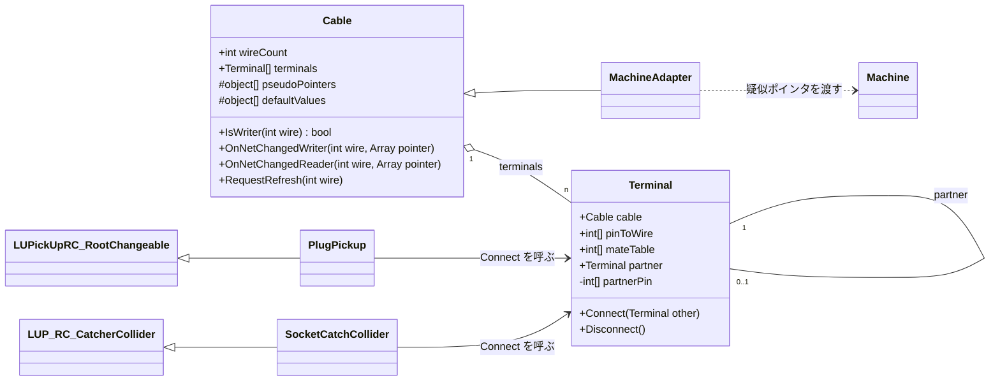
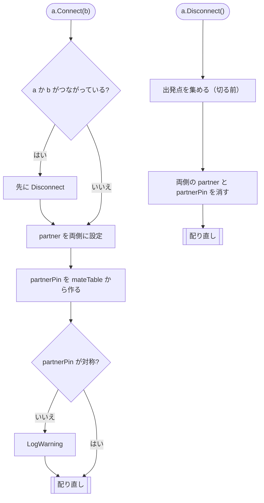
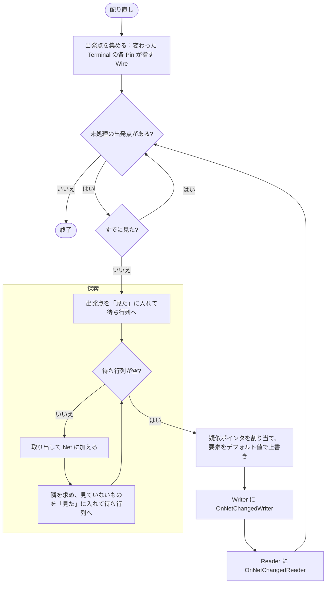

# UdonSharpPickupCable 設計メモ

2026-11-07 時点で決めた方針。実装はこれから。

## 目的

多芯ケーブルを扱えるようにする。次の場合も扱えること。

- ケーブルの途中で分岐する（Y 字ケーブルなど）
- 相手側に対応する Pin がないソケットがある
- 無性コネクタのように、Pin の対応（同じ番号どうしか、反転か）がコネクタごとに違う

設定する人の手間を増やさないため、**Wire（芯）ごとにコンポーネントを作らない**。多芯は Terminal（ソケット・プラグ）単位で扱う。

接続状態の同期は別の仕組みが行う。このパッケージは「つながった・切れた」を受けて、疑似ポインタを配り直すだけにする。

## 用語

| 用語 | 意味 |
|---|---|
| Cable | Wire と Terminal を持つもの。ケーブルや車体内の配線は基底のまま使い、機器との仲介は派生 |
| Wire | Cable の中の1本の導体（芯）。番号は Cable の中で共通 |
| Terminal | Cable の端。Pin を持ち、相手の Terminal と 1:1 でつながる。Cable と Terminal は 1:n |
| Pin | Terminal の中の1つの接点 |
| Net | つながっている (Cable, Wire) の集まり。電気的に同じ点 |
| 疑似ポインタ（PseudoPointer） | Net で共有する値の入れ物（`System.Array`。中身は `float[]` など） |
| Writer / Reader | 疑似ポインタに値を書く (Cable, Wire) と、読むだけの (Cable, Wire) |

### 疑似ポインタとは

Udon では、他のクラスのメンバを辿ってアクセスするとオーバーヘッドが大きい。値は毎フレーム読むことが多いので、そのたびにクラスから辿ると問題になる。そこで Net ごとに配列を1つ用意し、Writer と Reader にその配列の参照を直接持たせる。

ここから次の決まりが出てくる。

- Net が変わらない間は、同じ配列を使い続ける。
- Net が変わったときの通知が、Writer と Reader が持つ参照を差し替える唯一の機会になる。
- デフォルト値で上書きするときは、配列を作り直さずに**要素だけ書き換える**。作り直すと、Reader が古い配列を見続ける。

## 構造

### Cable（基底クラス）

| フィールド | 内容 |
|---|---|
| `wireCount` | Wire の数 |
| Wire ごとの疑似ポインタ | 各 Wire が自分専用の配列を1つ持つ（`object[]` に `float[]` などを入れる） |
| Wire ごとのデフォルト値 | Net が変わったときに疑似ポインタをこの値で上書きする。電気なら基本 0 |
| `terminals[]` | この Cable の Terminal |

仮想メソッド（名前は仮）:

- `IsWriter(wire)`: その Wire が Writer かどうか。基底は false
- `OnNetChangedWriter(wire, pointer)`: Writer への通知。参照を差し替えて、すぐ書き込む
- `OnNetChangedReader(wire, pointer)`: Reader への通知。参照を差し替える
- `RequestRefresh(wire)`: 書き込みをやめたときなどに呼ぶ。その Wire の Net だけ配り直す

基底の Cable は、そのままケーブルとして使える（通知では何もしない）。車体内の配線も、前後のジャンパ栓などを Terminal にした基底の Cable で表す。派生クラスは次の1つ:

- 機器との仲介: 機器に疑似ポインタを受け渡す。Writer / Reader は **Wire ごと**に持つ（Terminal 1 では書き込み、Terminal 2 では読み込み、もありえる）

### クラス図

`MachineAdapter` は仮の名前。メソッド名も仮。



### Terminal

| フィールド | 内容 |
|---|---|
| `cable` | 親の Cable |
| `pinToWire[]` | Pin → Wire。その Pin がなければ -1。1つの Wire を複数の Pin に割り当ててよい |
| `mateTable[]` | 自分の Pin p が相手の Pin `mateTable[p]` とつながる。空なら同じ番号どうし |
| `partner` | 相手の Terminal（1つ）。必ず両側で対称に持つ |
| `partnerPin[]` | 接続時に計算するキャッシュ。自分の Pin → 相手の Pin |

- Pin の割り当ては、ソケットを Prefab にするかコピーで揃える。
- プラグ / ソケット（`PlugPickup` / `SocketCatchCollider`）は Terminal を持ち、外部の同期から来た接続状態で Terminal の Connect / Disconnect を呼ぶ。Wire のことは知らなくてよい。

### スイッチ・リレー

Cable の中の Wire どうしをつないだり切ったりするときは、**同じ Cable の中の Terminal 2つ**を Connect / Disconnect する。

- 例: Wire 0 と Wire 1 の間のスイッチ。Pin を1つずつ持つ Terminal a と b を置く。

  ```csharp
  a.pinToWire = new int[] { 0 }; // a の Pin 0 → Wire 0
  b.pinToWire = new int[] { 1 }; // b の Pin 0 → Wire 1
  ```

  スイッチを入れたら `a.Connect(b)`。a の Pin 0 と b の Pin 0 が向かい合い、Wire 0 と Wire 1 が同じ Net になる。切ったら `a.Disconnect()`
- 多極スイッチは Terminal の Pin を増やす。切り替えスイッチは、共通側の Terminal 1つと接点側の Terminal 2つをつなぎ替える
- 探索や配り直しは外の接続と同じ流れに乗るので、専用のコードはいらない
- Connect は「相手が同じ Cable」を拒否しないこと

## 接続と切断

### Connect(a, b)

1. a か b がすでにつながっていれば、先に Disconnect する
2. `a.partner = b`、`b.partner = a`
3. 両側の `partnerPin` を `mateTable` から作る
4. 対称になっているか確かめる: `a.partnerPin[p] == q` なら `b.partnerPin[q] == p`。崩れていれば `LogWarning`
5. 出発点を集めて配り直す（下記）。出発点は、両側の Terminal の各 Pin が指す Wire（-1 は除く）

### Disconnect(a)

1. 出発点を先に集める（両側の Terminal の各 Pin が指す Wire）
2. 両側の `partner` と `partnerPin` を消す
3. 出発点から配り直す

### アクティビティ図



配り直し（Connect・Disconnect・スイッチ・`RequestRefresh` で共通）:



## 探索

点は (Cable, Wire)。(C, w) の隣は次のように求める。

```
foreach Terminal T in C.terminals
  U = T.partner; if U == null → 飛ばす
  foreach Pin p で T.pinToWire[p] == w
    q  = T.partnerPin[p]
    w2 = U.pinToWire[q]; if w2 < 0 → 飛ばす
    (U.cable, w2) が隣
```

- **出発点は必ず「見た」に入れて、待ち行列に入れる**。今のコードは出発点を入れていないので、どこともつながっていない線が更新されない。
- 出発点が複数あるときは、すでに見た点から始めない。これで1つの Net を探すのは1回になる。
- 出発点から辿れない部分は触らない。
- 見たかどうかの記録: 探索ごとに `DataDictionary` を作る。キーは Cable の参照（`DataToken`）、値はその Cable で見た Wire のビット（`int` で32本、`long` で64本まで）。管理用のコンポーネントは置かない。
- 待ち行列: 1つの `DataList` に Cable と Wire 番号を交互に入れる（または `DataList` を2本並べる）。

## 疑似ポインタの割り当てと値

各 Wire が自分の疑似ポインタを持つので、Net の疑似ポインタを「Net の中の誰かのもの」にすれば、別の Net と重ならない。

Net が変わったら（Connect・Disconnect・スイッチ・`RequestRefresh` のどれでも同じ手順）:

1. 探索で、変わった Net を見つける
2. Net に疑似ポインタを1つ割り当てる（Net の中の誰かのもの）。要素を**デフォルト値で上書き**する
3. Net の中の Writer 全員に `OnNetChangedWriter` を呼ぶ。ここですぐ書き込んでもらう
4. Net の中の Reader 全員に `OnNetChangedReader` を呼ぶ

- Writer がいない Net だけがデフォルト値に戻る。
- Writer と Reader の通知を分けるのは、Reader が書き込みより先に呼ばれてデフォルト値を読むのを防ぐため。
- 同じ Net に Writer が複数いるのはエラー動作として扱い、解決は利用者に任せる（どちらが勝つかは決めない）。
- デフォルト値は Wire ごとに持つが、電気なら基本 0 なので、Net の中で値が食い違う場合は気にしない。

## Udon で気をつけること

- static フィールドは使えない（はず）。世代番号のような全体で共有する値は置けないので、見たかどうかは探索ごとの `DataDictionary` で持つ。
- 組（タプル）やジェネリクスは使えない。
- `DataDictionary` のキーに UdonSharpBehaviour の参照を使ったとき、参照の同一性で比べられるかを最初に確かめる。
- 抽象メソッドは今のコードと同じく、`#if !COMPILER_UDONSHARP && UNITY_EDITOR` で abstract / virtual を切り替える。

## 今のコードからの変更点

- 今の `AbstractWire` は「ケーブル」の意味で使われている。新しい用語では Wire は芯なので、**意味が入れ替わる**。古い名前を残さないこと。
- `AbstractConnectableMachine.SetPointer` は、機器との仲介（Cable の派生）と `OnNetChangedWriter` / `OnNetChangedReader` に置き換わる。
- 今の「端子ごとに相手の線と相手の端子番号を持つ」形は、Terminal の `partner` に置き換わる。

今のコードの既知のバグ（作り直しで消える）:

1. どこともつながっていない線が更新されない（探索が出発点を入れていない）
2. すでにつながっている端子に別の線をつなぐと、前の相手に参照が残る（古い接続を自分の側しか外さない）
3. `SocketCatchCollider.PickupEnter` で、ソケットの線それぞれがプラグの全部の線とつながる（二重ループ）
4. `Start` で、両側のインスペクタに相手を設定していると二重に接続する

## まだ決めていないこと

- Wire が64本を超える Cable を許すか（「見た」の記録を `DataList` にするか）
- `partnerPin` の代わりに「自分の Wire → 相手の (Cable, Wire) の一覧」まで接続時にキャッシュするか
- Net の疑似ポインタを誰のものにするか（今使っているものの持ち主が Net の中にいれば使い続ける、など）。使い続ければ、Reader の参照を差し替えずに済む
