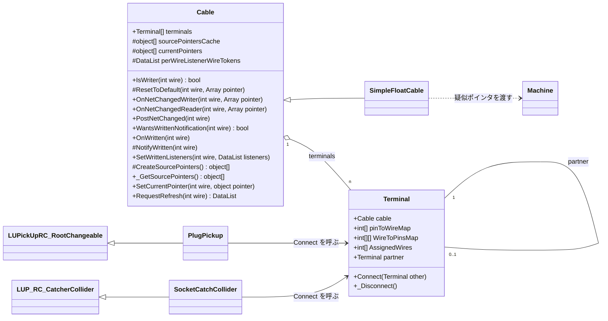
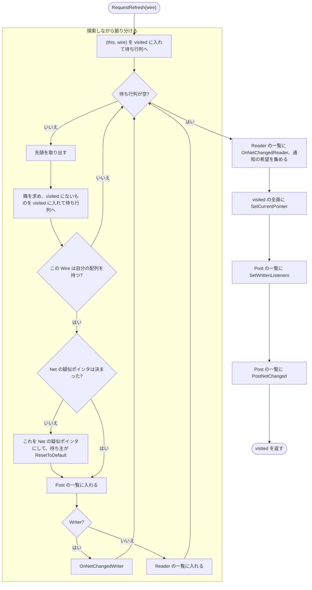

# UdonSharpPickupCable 設計メモ

2026-11-09 時点。Terminal の接続・切断、Cable の探索・疑似ポインタの割り当て・通知、書き込みの通知、プラグ / ソケット（LUPLinker）、`terminals` の自動設定まで実装済みで、テストがある。Wire 1本（`SimpleFloatCable`）、多芯とクロス配線（`SimpleMultiCable`）は Udon 上でも動作を確認した。書き込みの通知は Udon 上では未確認。機器は `Cable` を継承して Hook を実装すればつなげるので、専用の基底クラス（MachineAdapter）は作らない。使い方は `README.md`。

## 目的

多芯ケーブルを扱えるようにする。次の場合も扱えること。

- ケーブルの途中で分岐する（Y 字ケーブルなど）
- 相手側に対応する Pin がないソケットがある
- 無性コネクタのように、物理的なピンの対応（同じ番号どうしか、反転か）がコネクタごとに違う。これは Pin 番号の決め方で吸収する（下記の Pin）

設定する人の手間を増やさないため、**Wire（芯）ごとにコンポーネントを作らない**。多芯は Terminal（ソケット・プラグ）単位で扱う。

接続状態の同期は別の仕組みが行う。このパッケージは「つながった・切れた」を受けて、疑似ポインタを配り直すだけにする。

## 用語

| 用語 | 意味 |
|---|---|
| Cable | Wire と Terminal を持つもの。ケーブルや車体内の配線は基底のまま使い、機器との仲介は派生 |
| Wire | Cable の中の1本の導体（芯）。番号は Cable の中で共通 |
| Terminal | Cable の端。Pin を持ち、相手の Terminal と 1:1 でつながる。Cable と Terminal は 1:n |
| Pin | Terminal の中の1つの接点。番号は**相手と向かい合う位置の番号**で、相手の同じ番号の Pin とつながる。物理的なピン番号とは違うことがある |
| Net | つながっている (Cable, Wire) の集まり。電気的に同じ点 |
| 疑似ポインタ（PseudoPointer） | Net で共有する値の入れ物（`System.Array`。中身は `float[]` など） |
| Writer / Reader | 疑似ポインタに値を書く (Cable, Wire) と、読むだけの (Cable, Wire)。どちらも自分の配列を持つ Wire だけで、配列を持たない Wire（機器がつながっていない）はどちらでもない |

### 疑似ポインタとは

Udon では、他のクラスのメンバを辿ってアクセスするとオーバーヘッドが大きい。値は毎フレーム読むことが多いので、そのたびにクラスから辿ると問題になる。そこで Net ごとに配列を1つ用意し、Writer と Reader にその配列の参照を直接持たせる。

ここから次の決まりが出てくる。

- Net が変わらない間は、同じ配列を使い続ける。
- Net が変わったときの通知が、Writer と Reader が持つ参照を差し替える唯一の機会になる。
- デフォルト値で上書きするときは、配列を作り直さずに**要素だけ書き換える**。作り直すと、Reader が古い配列を見続ける。

## 構造

### Cable（基底クラス）

| フィールド | 内容 |
|---|---|
| `terminals[]` | この Cable の Terminal。**ビルド時に自動で設定する**ので、インスペクタには出さない（`[HideInInspector]`、下記の「自動設定」） |
| `sourcePointersCache[]` | Wire ごとの配送元用の配列。`CreateSourcePointers` の結果を保持する。機器がつながっていない Wire は null か範囲外 |
| `currentPointers[]` | Wire ごとに、今その Wire の Net が使っている疑似ポインタ（Net の中の誰かの配送元用の配列）。Net に配列がなければ null |
| `perWireListenerWireTokens` | Wire ごとに、書き込みの通知を受ける Reader の一覧（`DataList`。下記の「書き込みの通知」）。最初の配り直しまでは null |

どれも `[NonSerialized]`。`object[]` や `DataList` はシリアライズされないので、実行時に作る。

- **配送元用の配列は、必要になったときに作る**（`_GetSourcePointers` の初回）。Start の順番に依存しない。
- `currentPointers` は `SetCurrentPointer` が、必要な長さまで伸ばす。基底の Cable は Wire の数を知らないため。

継承先で実装するもの（基底は何もしない）:

- `CreateSourcePointers()`: Wire ごとの配列を作って返す。基底は空配列。呼ばれるのは1回だけ
- `IsWriter(wire)`: その Wire が Writer かどうか。基底は false
- `ResetToDefault(wire, pointer)`: pointer の要素をデフォルト値で上書きする。配列の型とデフォルト値を知っているのは継承先なので、基底にデフォルト値は持たない
- `OnNetChangedWriter(wire, pointer)`: Writer への通知。参照を差し替えて、すぐ書き込む
- `OnNetChangedReader(wire, pointer)`: Reader への通知。参照を差し替える
- `PostNetChanged(wire)`: Writer / Reader 共通の通知。Net が確定し、全員の通知と `currentPointers` の更新が終わったあとに呼ばれる
- `WantsWrittenNotification(wire)`: その Wire が Reader のとき、書き込みの通知を受けるかどうか。基底は false
- `OnWritten(wire)`: Reader への通知。同じ Net の Writer が `NotifyWritten` を呼んだときに呼ばれる

Cable が持つもの:

- `RequestRefresh(wire)`: 書き込みをやめたときなどに呼ぶ。その Wire の Net だけ配り直す。見つけた Net（下記の visited）を返す。主にテストと確認用で、使わなくてよい
- `_GetSourcePointers()`: 配送元用の配列を返す。なければ作る
- `SetCurrentPointer(wire, pointer)`: `currentPointers` を更新する
- `NotifyWritten(wire)`: 継承先の Writer が、疑似ポインタに書き込んだあとに呼ぶ（`protected`）
- `SetWrittenListeners(wire, listeners)`: 書き込みの通知を受ける Reader の一覧を差し替える

基底の Cable は、そのままケーブルとして使える（配列を持たないので、通知は届かない）。車体内の配線も、前後のジャンパ栓などを Terminal にした基底の Cable で表す。派生クラスは次の1つ:

- 機器との仲介: 機器に疑似ポインタを受け渡す。Writer / Reader は **Wire ごと**に持つ（Terminal 1 では書き込み、Terminal 2 では読み込み、もありえる）

継承先の書き方の例は `Samples/Scripts/SimpleFloatCable.cs`（Wire 1本、`float[1]`）と `SimpleMultiCable.cs`（多芯）。

**継承先の注意:** `IsWriter` を true にしても、その Wire の配列を作っていなければ通知は届かない。

### 自動設定（BuildProcess）

`Editor/BuildProcesses/CableBuildProcess.cs`。シーンの処理時に、各 Cable の `terminals` を「その Cable を参照している Terminal の一覧」で**上書き**する。

- 利用者が設定するのは Terminal の `cable` だけでよい。
- 順番はヒエラルキー順。非アクティブのものも含む。Terminal のない Cable は空配列になる。
- `cable` が未設定の Terminal と、参照先の Cable がそのシーンにない Terminal は、警告を出して飛ばす。
- `callbackOrder` は -300。ほかの BuildProcess が `terminals` を使えるように早くしている。
- U# の public フィールドなので、`SerializedObject` を使わず直接代入する。
- シーンの列挙などは utils の `frou01.util.editor.BuildProcessUtility` を使う（`com.frou01.utils` 9.1.0 以降）。

### クラス図

機器は `Cable` を継承したクラスからつなぐ（図では `SimpleFloatCable`）。



### Terminal

| フィールド | 内容 |
|---|---|
| `cable` | 親の Cable |
| `pinToWireMap[]` | Pin → Wire。その Pin がなければ -1。1つの Wire を複数の Pin に割り当ててよい |
| `WireToPinsMap` | `pinToWireMap` の逆引き。Wire → その Wire を割り当てた Pin 番号の配列（昇順）。長さは `pinToWireMap` の最大値 + 1 で、その Terminal に出てこない Wire は範囲外になる。初回のアクセスで作る（ジャグ配列はシリアライズされないため） |
| `AssignedWires` | `pinToWireMap` に出てくる Wire の番号（重複と -1 を除く、昇順）。接続・切断のときに `RequestRefresh` を呼ぶ Wire。初回のアクセスで `WireToPinsMap` から作る |
| `partner` | 相手の Terminal（1つ）。必ず両側で対称に持つ |

- 自分の Pin p は、相手の Pin p とつながる。物理的なピンの対応（無性コネクタを向かい合わせると並びが反転する、など）は、利用者が `pinToWireMap` を決めるときに吸収する。
  - 例: 交差するジャンパ線なら、ケーブルの両端の Terminal に `{ 0, 1, 2 }` と `{ 2, 1, 0 }` のように別の割り当てを持たせる。
- Pin の数が相手と違うときは、相手の `pinToWireMap.Length` 以上の番号の Pin は、相手がいないものとして飛ばす。
- Pin の割り当ては、ソケットを Prefab にするかコピーで揃える。
- プラグ / ソケット（`PlugPickup` / `SocketCatchCollider`）は Terminal を1つ持ち（`linkedTerminal`）、外部の同期から来た接続状態で Terminal の Connect / _Disconnect を呼ぶ。Wire のことは知らなくてよい。

### スイッチ・リレー

Cable の中の Wire どうしをつないだり切ったりするときは、**同じ Cable の中の Terminal 2つ**を Connect / _Disconnect する。

- 例: Wire 0 と Wire 1 の間のスイッチ。Pin を1つずつ持つ Terminal a と b を置く。

  ```csharp
  a.pinToWireMap = new int[] { 0 }; // a の Pin 0 → Wire 0
  b.pinToWireMap = new int[] { 1 }; // b の Pin 0 → Wire 1
  ```

  スイッチを入れたら `a.Connect(b)`。a の Pin 0 と b の Pin 0 が向かい合い、Wire 0 と Wire 1 が同じ Net になる。切ったら `a._Disconnect()`
- 多極スイッチは Terminal の Pin を増やす。切り替えスイッチは、共通側の Terminal 1つと接点側の Terminal 2つをつなぎ替える
- 探索や配り直しは外の接続と同じ流れに乗るので、専用のコードはいらない
- Connect は「相手が同じ Cable」を拒否しないこと
- 通知を受けて接点を動かすリレーは、`PostNetChanged` の中で Connect / _Disconnect する。`OnNetChangedWriter` は探索の途中で呼ばれるので、そこで接続を変えてはいけない
  - `PostNetChanged` の中で接続を変えると、外側の `RequestRefresh` のループの途中で内側の `RequestRefresh` が走る。残りのメンバーの `PostNetChanged` は、内側の更新が終わった状態で呼ばれる
  - リレーどうしがフィードバックすると止まらなくなることがある。解決は利用者に任せる

## 接続と切断

### this.Connect(other)

1. this か other がすでにつながっていれば、先に _Disconnect する
2. `this.partner = other`、`other.partner = this`
3. this の `AssignedWires` の各 Wire で `RequestRefresh` を呼ぶ。other の側は、つながったので探索で辿り着く

### this._Disconnect()

1. つながっていなければ何もしない
2. 両側の `partner` を消す
3. this と相手のそれぞれの `AssignedWires` の各 Wire で `RequestRefresh` を呼ぶ。出発点は Terminal の `pinToWireMap` から決まるので、`partner` を消したあとでも集められる

### アクティビティ図


`RequestRefresh(wire)`（Connect・_Disconnect・スイッチ・書き込みをやめたときで共通）:



- 出発点の Wire ごとに `RequestRefresh` を1回ずつ呼ぶ。同じ Net の Wire が複数あると、同じ Net を何度も探索する（動的な重複）。今は気にしない。直すなら、出発点をまとめて受け取り、すでに見た点からは始めない入口を作る。

## 探索

点は (Cable, Wire)。(C, w) の隣は次のように求める。

```
foreach Terminal T in C.terminals
  U = T.partner; if U == null → 飛ばす
  if w >= T.WireToPinsMap.Length → 飛ばす（T に w の Pin がない）
  foreach Pin p in T.WireToPinsMap[w]
    if p >= U.pinToWireMap.Length → 飛ばす
    w2 = U.pinToWireMap[p]; if w2 < 0 → 飛ばす
    (U.cable, w2) が隣
```

- **出発点は必ず visited に入れて、待ち行列に入れる**。旧コードは出発点を入れていなかったので、どこともつながっていない線が更新されなかった。
- 待ち行列に入れるときに visited にも入れる（取り出したときではない）。そうしないと、まだ取り出していない点が別の経路からもう一度入る。
- 出発点から辿れない部分は触らない。
- 点の表し方: 要素2つの `DataList`（[0] が Cable の参照、[1] が Wire 番号）。
- visited: 点の `DataList` を並べた `DataList`。探索が終わると、これがそのまま Net の一覧になる。管理用のコンポーネントは置かない。
- 見たかどうかの判定: `WireVisitedCheck(visited, cable, wire)`。visited を先頭から線形に探し、同じ Cable で `[1].Int` が同じ値のものがあれば見た。点の `DataList` は見ていないと分かってから作るので、確保は未訪問のときだけになる。探索全体で O(n²) になるが、探索は接続が変わったときにしか走らないので許容する。
  - `DataList.Contains` は使えない。中に入れた `DataList` を中身ではなく参照で比べるので、毎回作る点は見つからず、探索が止まらない。
  - `DataToken` 同士の `==` / `!=` も使えない。中身が同じでも、別に作った token 同士は等しくならない（文字列と null を除く）。値で比べるなら `Equals`、または `.Reference` / `.Int` を取り出して比べる。
- 待ち行列: 点の `DataList` を並べた `DataList`。先頭を `RemoveAt(0)` で取り出す。

### テスト

`Tests/`（asmdef は `frou01.UdonSharpPickupCable.Tests`）。

- `CableTests.cs`: 探索。Terminal の `partner` を直接書いて接続を作り、`RequestRefresh` が返す Net を、順番を問わず重複も許さずに比べる。`Connect` は中で探索を呼ぶので使わない。
  - 扱っている場合: どこともつながっていない Wire、Pin 番号による対応、ほかの Wire が混ざらないこと、相手の Pin が足りない・-1、分岐、同じ Wire を複数 Pin に割り当て、直列、辿れない Net、Cable の輪、ターミネーターで同じ Cable の2本の Wire をつなぐ、スイッチ。
- `CableNotificationTests.cs`: 疑似ポインタの割り当てと通知。Wire ごとに役割（None / Reader / Writer）を持つ `FakeCable` で、通知の順番と受け取った配列を記録する。
  - 扱っている場合: 配列の共有、ただの Cable を挟む、別の Net は別の配列、リセットと通知の順番と回数、書いた値とデフォルト値、配列を作り直さないこと、配列を持つメンバーがいない Net、配列を持たない Wire、`PostNetChanged`、`PostNetChanged` の中の Connect（リレー）、Connect / _Disconnect / つなぎ替え、`AssignedWires`、`NotifyWritten`（希望した Reader だけに届く、Reader の Wire 番号、別の Net に届かない、最初の配り直しの前、リスナーがいない Wire、`PostNetChanged` の中、接続・切断での一覧の更新）。
- `SimpleFloatCableTests.cs`: サンプルの動作と、`_DebugLogCurrentPointers` の出力。
- `CableBuildProcessTests.cs`: `terminals` の自動設定。テストランナーの無題のシーンを処理し、作業中のシーンは書き換えない。
- `Fake〜` はテストクラスのファイルの中に書く。Editor 専用の asmdef でファイル名とクラス名が一致すると、エディタスクリプト扱いになって `AddComponent` が null を返す。

## 疑似ポインタの割り当てと値

配列を持つのは (Cable, Wire) ごとなので、Net の疑似ポインタを「Net の中の誰かの配列」にすれば、別の Net と重ならない。

Net が変わったら（Connect・_Disconnect・スイッチ・`RequestRefresh` のどれでも同じ手順）:

1. 探索しながら、自分の配列を持つ Wire を見つけていく
2. 最初に見つけた配列を Net の疑似ポインタにする。持ち主が1回だけ `ResetToDefault` で上書きする
3. Writer には見つけた時点で `OnNetChangedWriter` を呼ぶ。ここですぐ書き込んでもらう。Writer は配列を持っているので、書き込みより前に必ずリセットが終わっている
4. 探索が終わったら、Reader 全員に `OnNetChangedReader` を呼ぶ。同時に `WantsWrittenNotification` が true の Reader を集める
5. visited の全員に `SetCurrentPointer` を呼ぶ（配列がなければ null）
6. Writer と Reader 全員に `SetWrittenListeners` で、集めた Reader の一覧を配る
7. Writer と Reader 全員に `PostNetChanged` を呼ぶ

- Writer がいない Net だけがデフォルト値に戻る。
- Writer と Reader の通知を分けるのは、Reader が書き込みより先に呼ばれてデフォルト値を読むのを防ぐため。
- Net に配列を持つ Wire がなければ、通知はしない（配る相手がいない）。`currentPointers` だけ null にする。
- `OnNetChanged〜` の時点では `currentPointers` はまだ古い。継承先は引数の `pointer` を使う。`PostNetChanged` の時点では更新済み。
- `OnNetChangedWriter` の時点では Net がまだ確定していない。接続を変えるなど、Net が確定している必要がある処理は `PostNetChanged` で行う。
- 同じ Net に Writer が複数いるのはエラー動作として扱い、解決は利用者に任せる（どちらが勝つかは決めない）。
- デフォルト値を決めるのは Net の疑似ポインタの持ち主。電気なら基本 0 なので、Net の中で値が食い違う場合は気にしない。
- 同じ Net に型の違う配列を持つ Wire が来るのは、利用者の設定ミスとして扱う。

## 書き込みの通知

Writer が値を書いたことを、Reader が毎回読み出さずに知るための仕組み。希望した Reader の Wire にだけ届く。毎フレーム変わる値は通知を使わず、Reader が Update で読み出す。

```csharp
// Writer 側（継承先）
pointer[0] = value;
NotifyWritten(wire);

// Reader 側（継承先）
public override bool WantsWrittenNotification(int wire) { return true; }
public override void OnWritten(int wire) { /* 疑似ポインタを読む */ }
```

- 配列に書いただけでは通知しない。Writer が `NotifyWritten` を呼んだときだけ届く。
- 通知の相手は配り直しのときに決まる。`WantsWrittenNotification` もそのときに読むので、あとから希望を変えたら `RequestRefresh` が要る。
- 一覧は Net に1つで、配列を持つ Wire 全員が同じ `DataList` を持つ。要素は探索と同じ点の `DataList`（Cable と Wire 番号）。
- Reader だけが一覧に入る。`NotifyWritten` を呼んだ Writer 自身にも、ほかの Writer にも届かない。
- 呼ぶタイミング:
  - `PostNetChanged` の中: `PostNetChanged` より先に一覧を配っているので、新しい一覧の相手に届く。
  - `OnNetChangedWriter` の中: 一覧はまだ前の配り直しのもの。最初の配り直しなら一覧がなく、何も起きない。Reader は `OnNetChangedReader` や `PostNetChanged` で値を読めるので、ここで呼ぶ必要はない。
  - 最初の配り直しの前: 何も起きない。
- `OnWritten` の中で別の Wire に書いて `NotifyWritten` を呼んでもよい（`[RecursiveMethod]`）。通知がループすると止まらなくなるので、解決は利用者に任せる。
- `OnWritten` の中で接続を変えても、走っているループは古い一覧のまま最後まで回る。

## Udon で気をつけること

- static フィールドは使えない（はず）。世代番号のような全体で共有する値は置けないので、見たかどうかは探索ごとの visited で持つ。static クラスの static メソッドは使える（`LogUtil`）。
- 組（タプル）やジェネリクスは使えない。
- `DataList` を `foreach` で回せない（U# のコンパイルで `Cannot get element type on non-array types` になる）。`for` とインデックスで回す。
- `DataList.Contains` と `DataToken` の `==` の比較は値ではない（「探索」を参照）。
- ジャグ配列（`int[][]`）は使えるが、シリアライズされない。BuildProcess で非公開フィールドに入れても残らないので、初回のアクセスで作る。
- 同じクラスの別のインスタンスの private メソッドも呼べる（`SetCurrentPointer` で確認済み）。
- Start の順番は決まっていない。ほかの Cable の配列を使うときは、作られている前提にしない。
- 継承先で実装するものは abstract にせず virtual にする。基底の Cable をそのまま使えるようにするためで、U# の abstract を切り替える `#if` も要らない。
- 同じインスタンスのメソッドに再入すると、`[RecursiveMethod]` がなければローカル変数が壊れる。`PostNetChanged` や `OnWritten` の中から再入しうる `RequestRefresh` と `NotifyWritten` に付けている。
- テストはエディタ上の C# として動く。Udon 上の動作は実際に動かして確かめる。
  - 確認済み: `protected virtual` の別インスタンス呼び出しと `object[]` から `Array` へのキャスト（`SimpleFloatCable`）。多芯（型の違う Wire が混ざる場合も）、クロス配線、Pin の数が違う相手（`SimpleMultiCable`、`Samples/Scenes/WireTest_MultiWire.unity`）。
  - 未確認: 書き込みの通知、`RequestRefresh` と `NotifyWritten` の再入。

## 名前（NamingConventionProposal.md との対応）

- asmdef は `frou01.UdonSharpPickupCable.Runtime`、名前空間は `frou01.UdonSharpPickupCable`。スクリプトは `Runtime/Scripts/` に置く。
- サンプルは `Samples/`。asmdef と名前空間は `frou01.UdonSharpPickupCable.Samples` で、Runtime / Editor には分けない。スクリプトは `Samples/Scripts/`、シーンは `Samples/Scenes/` に置く。
- 配列のフィールドは複数形にする（`terminals`、`currentPointers` など）。対応表は `<キー>To<値>Map` とし、1つのキーに対する値の数に合わせる（`pinToWireMap`、`wireToPinsMap`）。
- 引数のない public メソッドは `SendCustomNetworkEvent` でリモートから呼べてしまうので、`_` を付ける（`_Disconnect()`、`_GetSourcePointers()`）。引数のある `Connect(Terminal)` はネットワークイベントで呼べないので付けない。SDK のバージョンで扱いが変わっているので、実装時に確認する。
- テスト用の偽物は `Fake〜` にする。

## 旧コードからの変更点

- 旧コードの `AbstractWire` は「ケーブル」の意味で使われていた。新しい用語では Wire は芯なので、**意味が入れ替わった**。古い名前を残さないこと。
- `AbstractConnectableMachine.SetPointer` は、機器との仲介（Cable の派生）と `OnNetChangedWriter` / `OnNetChangedReader` に置き換わる。
- 旧コードの「端子ごとに相手の線と相手の端子番号を持つ」形は、Terminal の `partner` に置き換わった。

旧コードの既知のバグ:

1. どこともつながっていない線が更新されない（探索が出発点を入れていない）: 解消済み。テストあり
2. すでにつながっている端子に別の線をつなぐと、前の相手に参照が残る（古い接続を自分の側しか外さない）: 解消済み。テストあり
3. `SocketCatchCollider.PickupEnter` で、ソケットの線それぞれがプラグの全部の線とつながる（二重ループ）: LUPLinker の書き直しで解消（Terminal 1つどうしの Connect になった）
4. `Start` で、両側のインスペクタに相手を設定していると二重に接続する: 接続を Start で行わなくなったので解消

## まだ決めていないこと

- 最初の配り直しを誰がいつ呼ぶか。`SimpleFloatCable` は Start から `RequestRefresh` を呼び、`currentPointers` に入っていれば飛ばしている。基底で共通化するかは未定で、今は継承先に任せている
- 無性コネクタの表示: LUPick の基底から分岐し、接触で Constraint の Source を切り替えて、常時中点へ移動する表示器にする案（未実装）
- 接続の可否: `SocketCatchCollider.validationPickup` をオーバーライドして、`PlugPickup.GetPlugTypeName` で判定する（Udon 上では未確認）
- 継承側のインスペクタで、Wire ごとの型と名前を表示できるか（発展的な課題）
- Net の疑似ポインタの選び方。今は探索で最初に見つけた配列。今使っているものの持ち主が Net の中にいれば使い続けるようにすれば、Reader の参照を差し替えずに済む
